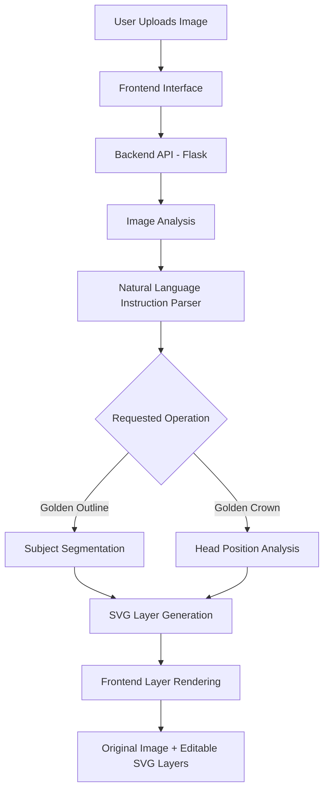

# LayerShift
### Generate Editable Layers, Not Flat Pixels.

**LayerShift** is an AI-powered image editing system designed to transform simple natural-language instructions into independent, editable vector layers.

Instead of modifying the original image permanently, LayerShift generates separate SVG layers that can be independently managed and exported.

---

## 🏆 Hackathon Information

| Detail | Information |
|---|---|
| Hackathon | GeNNarrative Clash 2026 |
| Track | Visual Art & Design Assist |
| Phase | Phase 02 – MVP |
| Team Name | Cognivex |
| Project | LayerShift |

### 👥 Team Cognivex

- Gitika Kasyap
- Yashraj Singh
- Naman Kumar
- Samanvitha Modi

---

## 🎬 Demo Video

[Watch the LayerShift Demo](https://drive.google.com/file/d/1wi9YBgC_523IcV4H0AW2FLUkVHGag32W/view?usp=drivesdk)

---

## 💡 Problem Statement

Traditional image editing tools often require users to have professional design skills and manually perform complex editing operations.

Most AI image editing systems modify or regenerate the entire image, making individual elements difficult to edit independently.

This creates several challenges:

- Users need technical design knowledge.
- Small editing instructions can affect the entire image.
- Generated elements are often not independently editable.
- Maintaining the original image while adding new elements can be difficult.

## 🚀 Our Solution

LayerShift introduces an instruction-driven image editing approach.

Users upload an image and describe the changes they want using natural language.

The system analyzes the uploaded image, interprets the instruction, and generates a separate SVG layer containing the requested visual element.

**The original image remains unchanged. Generated elements remain independent and editable.**

---

## ✨ Core Demonstration Workflows

### 1. AI-Powered Golden Outline Generation

**User Instruction:**

`Create a complete golden outline around the subject.`

**Workflow:**

1. User manually uploads an image.
2. LayerShift analyzes the image and identifies the main subject.
3. The system generates the subject's outer silhouette.
4. A golden outline is created as a separate SVG layer.
5. The generated outline can be viewed and edited independently.

**Expected Result:** A complete golden outline surrounding the subject while preserving the original image.

### 2. Dynamic Golden Crown Generation

**User Instruction:**

`Add a golden crown above the head.`

**Workflow:**

1. User uploads an image.
2. LayerShift analyzes the subject and identifies the head position.
3. The system estimates the appropriate crown position and dimensions.
4. A golden crown is generated as a separate SVG layer.
5. The crown remains independent of the original image.

**Expected Result:** A properly positioned golden crown above the subject's head.

---

## 🌟 Key Features

- Natural-language image editing instructions.
- AI-assisted image understanding.
- Subject detection and outline generation.
- Dynamic placement of generated visual elements.
- Independent SVG layer generation.
- Preservation of the original uploaded image.
- Editable vector-based output.

*Feature availability may depend on the current implementation and configured AI services.*

---

## 🛠️ Technology Stack

### Frontend
- React
- TypeScript
- Vite
- Tailwind CSS

### Backend
- Python
- Flask

### AI & Image Processing
- Google Gemini Vision API
- OpenCV
- Pillow
- SVG Generation

---

## 🏗️ System Architecture



---

## 📂 Project Structure

The project is organized into separate frontend and backend components.

```text
LayerShift/
│
├── frontend/
│   ├── src/
│   │   ├── components/
│   │   ├── services/
│   │   ├── store/
│   │   └── App.tsx
│   ├── public/
│   └── package.json
│
├── backend/
│   ├── app.py
│   ├── services/
│   ├── tests/
│   └── requirements.txt
│
├── README.md
└── .gitignore


## ⚙️ Installation & Setup

### Prerequisites

- Python 3.10 or later
- Node.js and npm
- Git

### 1. Clone the Repository

```bash
git clone https://github.com/yashrajsingh69/LayerShift.git
cd LayerShift
```

### 2. Setup Backend

```bash
cd backend
python -m venv venv
```

Activate the virtual environment on Windows:

```cmd
venv\Scripts\activate
```

Install dependencies:

```bash
pip install -r requirements.txt
```

Start the backend:

```bash
python app.py
```

### 3. Setup Frontend

Open another terminal:

```bash
cd frontend
npm install
npm run dev
```

Open the local URL displayed in the terminal.

---

## 🔐 Environment Configuration

If Gemini API integration is enabled, configure your API key through an environment variable.

Example `.env`:

```env
GEMINI_API_KEY=your_api_key_here
```

Never commit API keys, credentials, or sensitive configuration files to GitHub.

---


## 🔮 Future Scope

- More natural-language editing operations.
- Advanced object and background segmentation.
- Improved vector geometry and precision.
- Multiple independent generated layers.
- Advanced layer transformation controls.
- More export formats.
- Improved AI-assisted creative workflows.

---

## 🎯 Project Vision

LayerShift aims to make professional visual editing more accessible through natural language and editable vector-based generation.

**Our goal is simple: Let users describe what they want, while LayerShift handles the visual complexity.**

---

## 👨‍💻 Developed By

**Team Cognivex**

GeNNarrative Clash 2026  
Visual Art & Design Assist Track

**LayerShift — Generate Editable Layers, Not Flat Pixels.**
